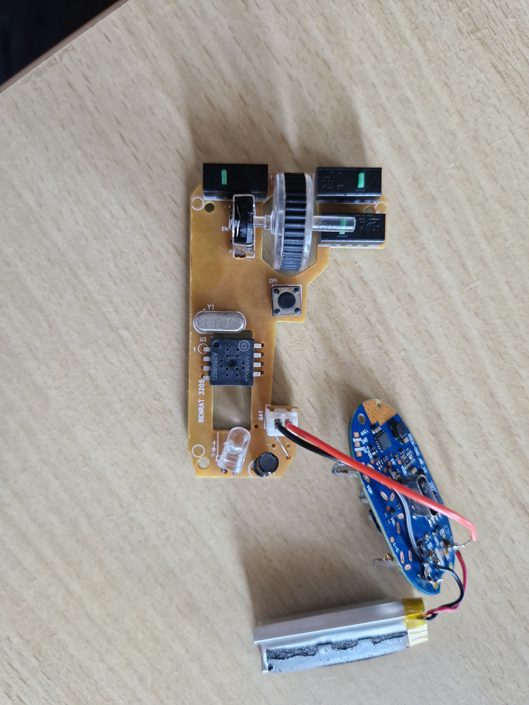
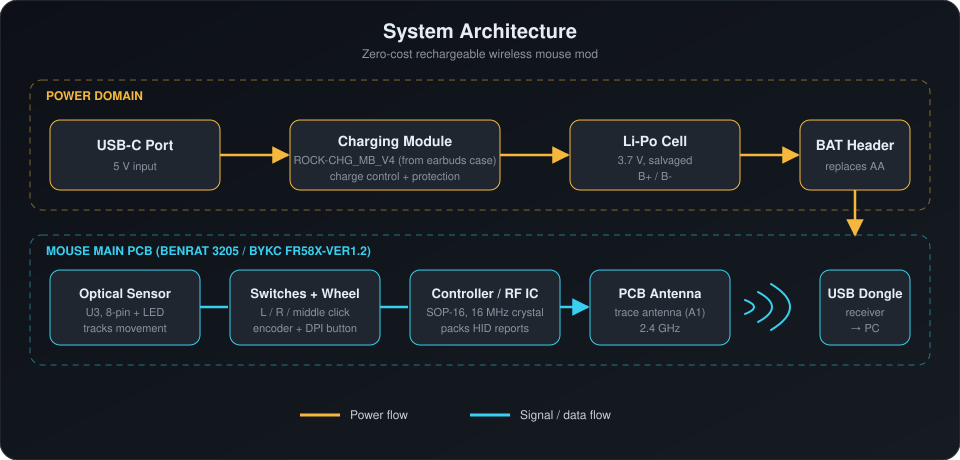
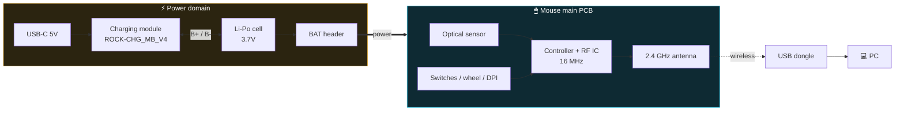
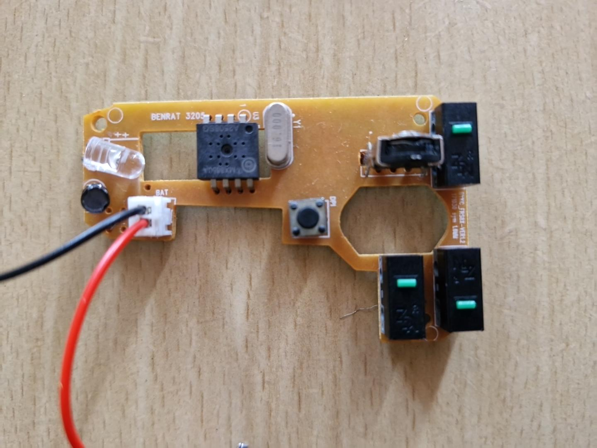
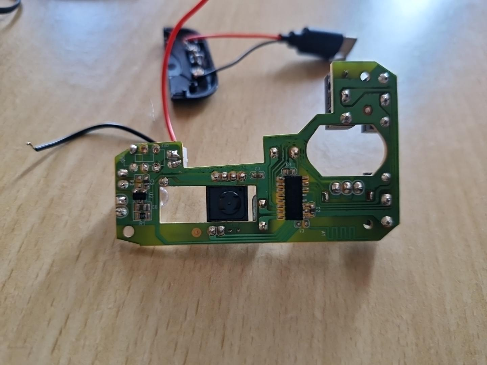
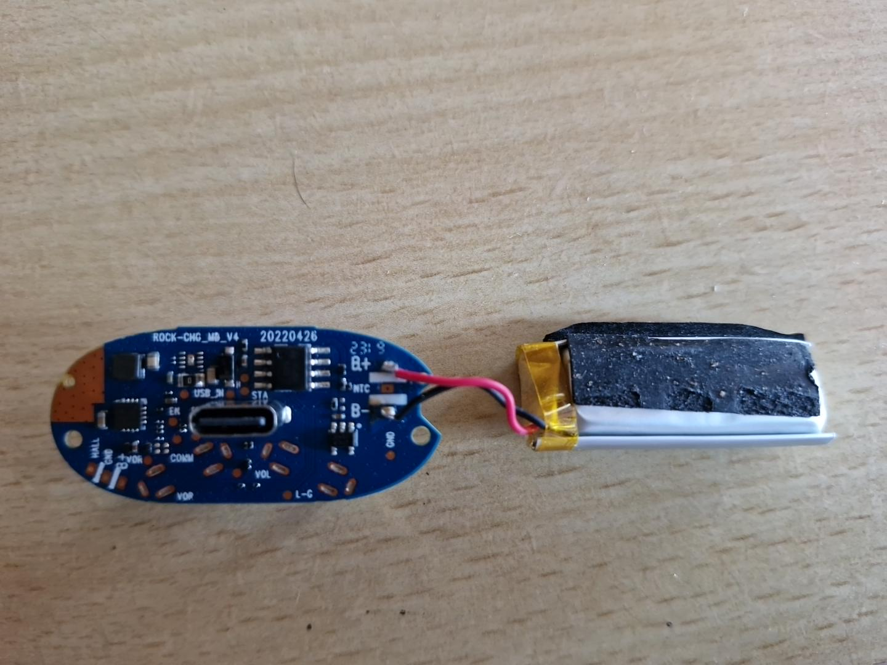
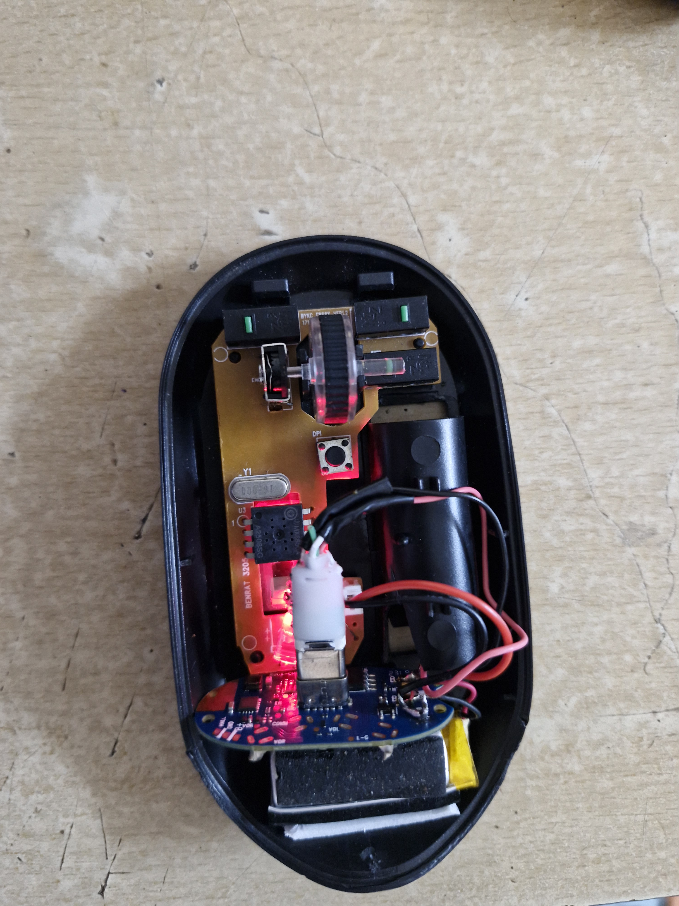
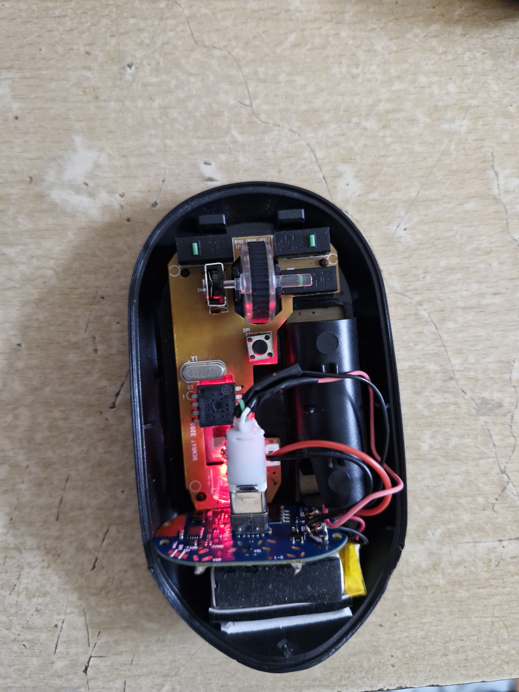

<div align="center">

# 🔋 ReCharge Mouse

### Turning a battery-hungry wireless mouse into a USB-C rechargeable one, at **₹0 / $0** cost.




*One dead pair of earbuds + one battery-eating mouse = one rechargeable mouse.*

</div>

---

## 📖 Table of Contents

- [About](#-about)
- [Features](#-features)
- [Parts Used](#-parts-used)
- [System Architecture](#-system-architecture)
- [How It Works (Animated)](#-how-it-works)
- [Wiring](#-wiring)
- [Build Steps](#-build-steps)
- [Photo Gallery](#-photo-gallery)
- [Safety Notes](#-safety-notes)
- [Known Limitations & Future Work](#-known-limitations--future-work)
- [Contributing](#-contributing)
- [License](#-license)

---

## 💡 About

My wireless mouse ran on a replaceable battery. Every time it died, I had to buy a new one, and it kept happening.

Instead of spending money, I dug into my e-waste drawer. A **damaged pair of earbuds** (or their charging case) had two very useful things:

1. a healthy **Li-Po cell**, and
2. a **USB-C charging module** (`ROCK-CHG_MB_V4`) that already knows how to charge that cell safely.

I wired the module and cell into the mouse in place of the battery. Plug in a USB-C cable, charge, unplug, and keep working. **Total cost: zero.**

---

## ✨ Features

| | |
|---|---|
| ♻️ **Zero cost** | Every part was salvaged from e-waste |
| 🔌 **USB-C charging** | Charge from any phone charger or PC port |
| 🧩 **Non-destructive to the mouse core** | The original sensor, switches and RF circuit are untouched |
| 🔁 **Reusable** | No more disposable batteries |
| 🛠️ **Beginner friendly** | A soldering iron and a multimeter are enough |

---

## 🧰 Parts Used

| # | Part | Source | Notes |
|---|------|--------|-------|
| 1 | Wireless optical mouse (2.4 GHz) | Original mouse | Main PCB marked `BENRAT 3205` / `BYKC FR58X-VER1.2` |
| 2 | Li-Po cell (3.7 V) | Damaged earbuds | Pouch cell with its leads |
| 3 | USB-C charging module | Damaged earbuds | Board marked `ROCK-CHG_MB_V4 20220426` |
| 4 | Hook-up wire (red / black) | Scrap | For `BAT` header and cell leads |
| 5 | Soldering iron + solder | Workbench | |
| 6 | Hot glue / insulating tape | Workbench | Fix the module, insulate joints |

### What's on the mouse PCB

| Ref | Component | Role |
|-----|-----------|------|
| `U3` | 8-pin optical sensor | Tracks surface movement |
| `Y1` | 16.000 MHz crystal | System clock |
| `ENC` | Rotary encoder | Scroll wheel |
| `DPI` | Tactile button | Cycles DPI |
| `BAT` | 2-pin JST-style header | **Power input, where the new battery connects** |
| Bottom side | SOP-16 controller / RF IC + trace antenna `A1` | Builds the packets and talks 2.4 GHz to the dongle |

### What's on the charging module

| Pad / Part | Meaning |
|-----------|---------|
| USB-C receptacle | 5 V input |
| `B+` / `B-` | Li-Po cell connections |
| `NTC` | Battery thermistor pad (unused) |
| `USB_IN`, `STA`, `EN`, `GND` | Charger status / enable / ground |
| `VOR`, `VOP`, `VOL`, `COMM`, `HALL`, `L-C` | Earbud-case specific pads |

---

## 🏗 System Architecture

<div align="center">
  
</div>

The same architecture as a Mermaid diagram (rendered natively by GitHub):



---

## 🎬 How It Works

<div align="center">
  
</div>

1. **Charge:** USB-C 5 V enters the charging module, which controls the charge current into the Li-Po cell.
2. **Power:** The cell feeds the mouse's `BAT` header, replacing the original disposable battery.
3. **Sense:** The optical sensor and switches report movement and clicks to the controller.
4. **Transmit:** The controller encodes the data and sends it over **2.4 GHz** to the USB dongle, and the cursor moves.

---

## 🔌 Wiring

```
                     ┌───────────────────────┐
   USB-C  ─────────► │  ROCK-CHG_MB_V4       │
   (5 V)             │  charging module      │
                     │                       │
                     │   B+ ───────┐         │
                     │   B- ───┐   │         │
                     └─────────┼───┼─────────┘
                               │   │
                          ┌────┴───┴────┐
                          │ Li-Po 3.7 V │
                          └────┬───┬────┘
                               │   │
                     (+) red   │   │  (-) black
                               ▼   ▼
                     ┌───────────────────────┐
                     │ Mouse PCB  "BAT"      │
                     │ header (+ / -)        │
                     └───────────────────────┘
```

| From | To | Wire |
|------|----|------|
| Module `B+` | Li-Po `+` | Red |
| Module `B-` | Li-Po `-` | Black |
| Li-Po `+` (via module output) | Mouse `BAT +` | Red |
| Li-Po `-` / module `GND` | Mouse `BAT -` | Black |

> ⚠️ **Verify polarity with a multimeter before connecting.** Match the `+` / `-` marking printed next to the mouse `BAT` header.

---

## 🛠 Build Steps

1. **Open the mouse** and remove the old battery holder wiring.
2. **Desolder the earbud board and cell** carefully. Never short the cell leads.
3. **Identify `B+` and `B-`** on the charging module and connect the Li-Po cell.
4. **Test charging** outside the mouse first: plug in USB-C and confirm the module's charge indicator and cell voltage (about 3.0–4.2 V).
5. **Connect the output to the mouse `BAT` header**, red to `+` and black to `-`.
6. **Power-test** the mouse with the cover open and confirm the cursor moves.
7. **Position and fix** the module so the USB-C port lines up with a cutout, then secure it with hot glue.
8. **Insulate** all joints with tape or heat-shrink, then close the case.

---

## 🖼 Photo Gallery

| Mouse PCB (top) | Mouse PCB (bottom) |
|:---:|:---:|
|  |  |

| Charger module + Li-Po | Assembled inside shell |
|:---:|:---:|
|  |  |

<div align="center">
  
  <br/><em>Powered on and working with LED lit.</em>
</div>

---

## ⚠️ Safety Notes

Lithium-polymer cells can swell, vent or catch fire if mishandled.

- Never short, puncture or bend the cell.
- Use **only** a charging module designed for a single-cell Li-Po, and never charge a swollen cell.
- Insulate every exposed joint, and keep wiring away from the sharp edges of the case.
- Do not leave the mouse charging unattended for long periods, especially at first.
- **Voltage check:** the mouse was designed for a ~1.5 V cell, and a fresh Li-Po is up to ~4.2 V. Measure the voltage at `BAT` first. If the board has no regulation for this, add a small regulator or diode drop to bring it into the chips' safe range.

---

## 🚧 Known Limitations & Future Work

- [ ] Add a cutout and strain relief for the USB-C port
- [ ] Add a voltage regulator / diode drop if the board needs it
- [ ] Add a power switch to cut the cell when idle
- [ ] Measure real battery life (mAh and hours of use)
- [ ] Add a low-battery indicator

---

## 🤝 Contributing

Ideas and improvements are welcome. Open an issue or submit a pull request.

## 📜 License

Released under the [MIT License](LICENSE). Build it, mod it, share it, but at your own risk.

---

<div align="center">

**If this saved you a trip to buy batteries, drop a ⭐ on the repo!**

*Made with solder, curiosity and e-waste. ♻️*

</div>
